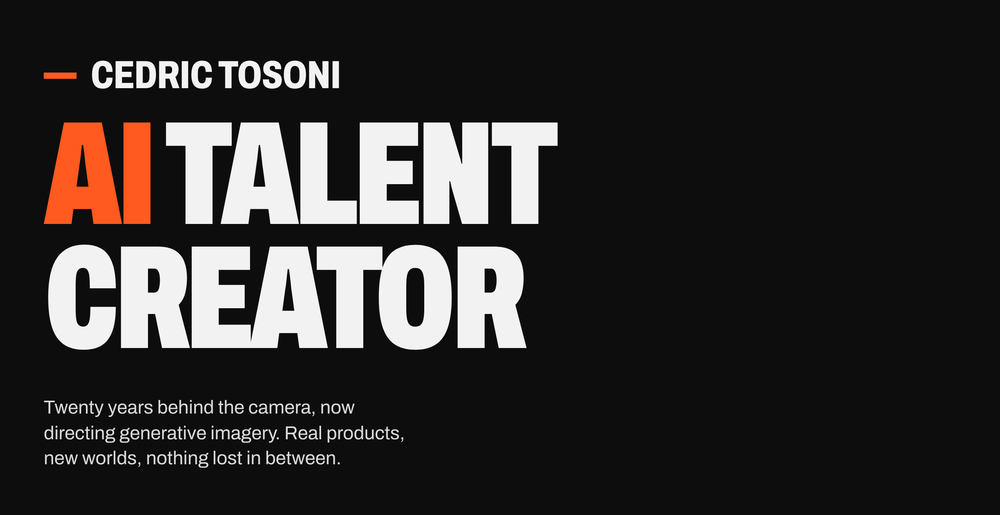
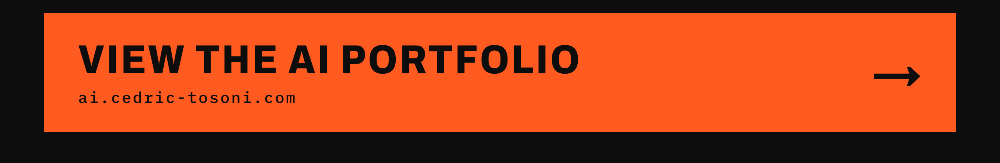
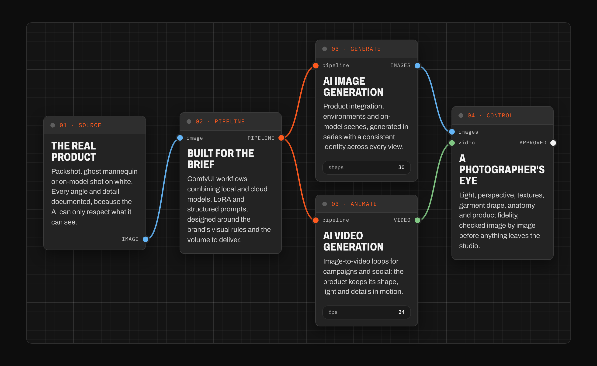

 

## Process

 

## About

I have been a professional photographer since 2007: fashion, e-commerce, luxury, architecture and editorial, including ten years in London.

Today I create commercial imagery with generative AI. I set the art direction for a brand’s visuals, then turn product and on-model shots into campaign-ready scenes, keeping the product, the garment and the model’s identity exactly right. Recent AI work includes e-commerce imagery for Adidas, among other clients.

I design the ComfyUI pipelines behind each project and build my own tools for the hard problems of generative imagery: consistent identity, multi-view generation and virtual casting.

 

<b>SERVICES</b> 
Art direction · AI image and video production · ComfyUI workflows · Virtual talents and casting
 

<b>LANGUAGES</b> 
French (native) · English (fluent)
 

<b>TOOLS</b> 
ComfyUI · Stable Diffusion · Flux · Nano Banana · Midjourney · LoRA · Photoshop · Capture One · Figma
 

<b>CLIENTS</b> 
Adidas (AI imagery) · Galeries Lafayette · Coca-Cola France · Canon · Ubisoft · Carrefour · Airbus · SEAT · Velux · Le Fouquet's · Elite Model Look
 

<b>PUBLISHED</b> 
Elle France · Maxim · Normal Magazine
 

<b>AWARDS</b> 
Px3 Bronze, Portrait (2016) 
Monochrome Awards, honourable mention (2018) 
Digit Photo Competition, first prize (2018)
 

 

## Let’s make it real

**Portfolio** · [ai.cedric-tosoni.com](https://ai.cedric-tosoni.com)  
**Email** · [contact@cedric-tosoni.com](mailto:contact@cedric-tosoni.com)  
**LinkedIn** · [linkedin.com/in/cedric-tosoni](https://www.linkedin.com/in/cedric-tosoni/)  
**Behance** · [behance.net/cedric-tosoni](https://www.behance.net/cedric-tosoni)  
**Instagram** · [@cedric_tosoni_ai](https://www.instagram.com/cedric_tosoni_ai)  
